## About

I work in logistics, so I think in flows: orders, documents, inventory, handoffs. That mindset shows up in my code as clear data models, strict validation, and admin dashboards that real teams can run on. Outside of work, K-beauty and skincare are a quiet obsession, which is how my flagship project started.

## Tech Stack

<table>
  <tr><td width="160">INTERFACE</td><td>HTML &nbsp;/&nbsp; CSS &nbsp;/&nbsp; JavaScript &nbsp;/&nbsp; Vue 3</td></tr>
  <tr><td>SERVER</td><td>Node.js &nbsp;/&nbsp; Express &nbsp;/&nbsp; REST APIs &nbsp;/&nbsp; cookie-based auth</td></tr>
  <tr><td>DATA</td><td>MySQL &nbsp;/&nbsp; schema design &nbsp;/&nbsp; Docker</td></tr>
  <tr><td>DESKTOP</td><td>Electron</td></tr>
  <tr><td>FUNDAMENTALS</td><td>C++ &nbsp;/&nbsp; Java &nbsp;/&nbsp; linked lists, BSTs, graphs</td></tr>
</table>

## GitHub Stats

  

